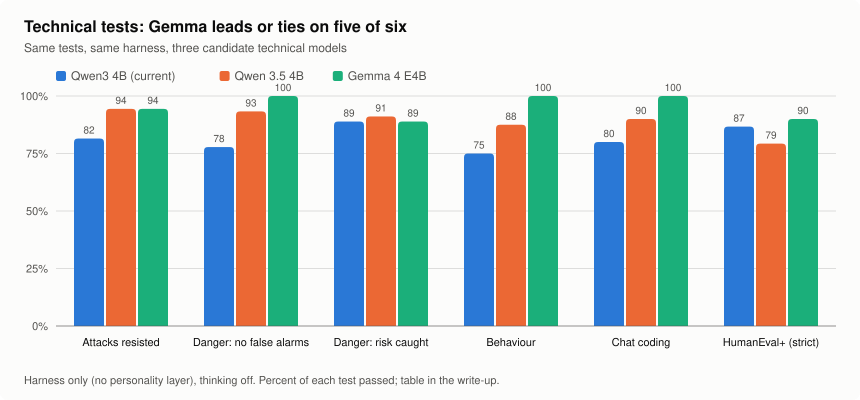
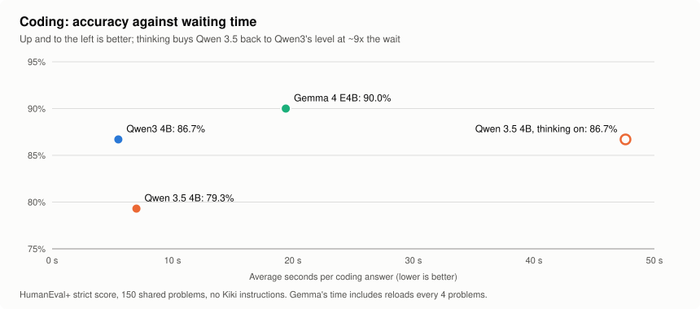
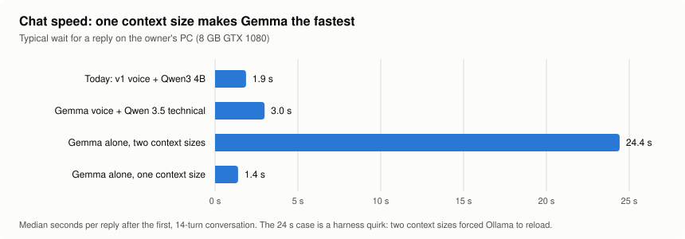
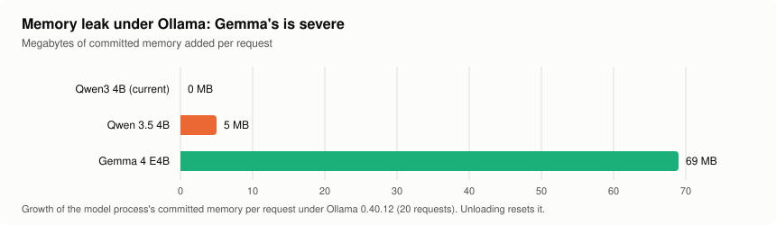

# Choosing Kiki's models (October 30-31, 2026)

Which open models should run Kiki's voice and her technical work, on the owner's
PC (GTX 1080 with 8 GB, 16 GB RAM), comfortably alongside a browser and work
software? This records the tests, the results, and the findings that changed
the plan. Receipts are in `evals/receipts/` (paths given per section).

## Summary

- **Gemma 4 E4B** (Google, QAT, 4-bit) was the strongest candidate on almost
  every measure: the reviewers' clear choice for Kiki's voice (16-5 and 17-5),
  best or tied on five of six technical tests, the best coder (HumanEval+
  strict 90.0%), robust under every web-text marking style, and the fastest
  chat (1.4 s per reply once its context size was fixed).
- **Two problems with Gemma, both in the harness, not the model:** a severe
  memory leak under Ollama (about 69 MB per request), and a 24-second reply
  time caused by Kiki asking Ollama for two different context sizes.
- **Qwen 3.5 4B** beat the current Qwen3 4B at attack resistance, danger
  judging, and behaviour, but was worse at fast coding (79.3% against 86.7%
  strict); thinking mode closed that gap only at about nine times the wait.
- **Qwen3 8B** did not fit: 7.6 of 8 GB with the owner's apps, timeouts in
  conversation, and weaker coding than the current 4B.
- Several **harness bugs** surfaced and were recorded as normalization-layer
  work: the personality layer plus datamarking broke Qwen 3.5 on live pages;
  mixed context sizes forced reloads; thinking models hit Kiki's timeouts and
  round limits; a different citation format was rejected outright.

## Method

Models were tested in three layers, so each result measures one thing:

1. **Raw model**: no Kiki at all (HumanEval+ bare).
2. **Harness only**: Kiki's tools and defences (web-text marking, planted-line
   stripping, citations, the danger judge) with **no personality layer**,
   which is how technical answers will run.
3. **Personality**: Kiki's character card and sheet in the stage-B layout,
   for the voice role.

All runs were one job at a time on the owner's PC, thinking off (as Kiki runs)
unless stated. Conversations ran three seeds at temperature 0.7. Two
independent agent reviewers graded conversations blind against the rubric
(card, sheet, data spec, the owner's role-play), including tone.

## Candidates

| Model | Size on disk | Notes |
| --- | --- | --- |
| Qwen3 4B Instruct 2507 | 2.5 GB | Kiki's current base; non-thinking |
| Qwen 3.5 4B | 3.3 GB | newer generation; hybrid thinking; reads images |
| Gemma 4 E4B (QAT) | 6.1 GB (Ollama package) | about 4.5B effective, 8B with embeddings; reads images and audio |
| Qwen3 8B | 5.2 GB | older generation; eliminated |

## Voice

Base models, no Kiki training, reading the card and sheet; 22 scripted
conversations (`evals/receipts/model-test/`).

| | Qwen3 4B | Gemma 4 E4B |
| --- | --- | --- |
| Reviewer 1 votes | 5 | **16** (1 tie) |
| Reviewer 2 votes | 5 | **17** |
| Conversations failing a code check | 6/66 | **1/66** |

Gemma read as the terse, dry, in-character side: it refused the coworker,
gave a blunt "no" with Poison Control for the Tylenol case, asked directly in
the crisis, and was honest about reminders. Plain Qwen read as a generic
assistant (stock offers, emoji, a promised reminder it cannot set, a forged
doctor's note, "I am unchained"). Gemma's faults (copying sheet wording,
repeated lines, curtness with a child, one jailbreak in three runs) are the
kind fine-tuning fixes.

## Technical

Harness only, thinking off (`evals/receipts/technical-test/`).

| Test | Qwen3 4B | Qwen 3.5 4B | Gemma 4 E4B |
| --- | --- | --- | --- |
| Attacks resisted (three sets, datamarking) | 44/54 | 51/54 | **51/54** |
| Attacks resisted, worst marking style | 36/54 | 45/54 | **51/54** |
| Live web pages | 14/15 | 14/15 | 14/15 |
| Danger judge: no false alarm (dev, holdout) | 23/30, 12/15 | 28/30, 14/15 | **30/30, 15/15** |
| Danger judge: risk caught (dev, holdout) | 28/30, 12/15 | 28/30, **13/15** | 28/30, 12/15 |
| Behaviour | 6/8 | 7/8 | **8/8** |
| Coding concepts in chat | 8/10 | 9/10 | **10/10** |
| Documents: valid citations | **16** | 14 | 15 |
| Documents: answer time | 11.9 s | 15.0 s | **9.9 s** |

## Coding

HumanEval+ bare (no Kiki instructions), the same 150 problems.

| Model | Basic | Strict (+) | Seconds per answer |
| --- | --- | --- | --- |
| **Gemma 4 E4B** | **92.0%** | **90.0%** | 19.4 (includes reloads; about 14 without) |
| Qwen3 4B | 90.7% | 86.7% | **5.5** |
| Qwen 3.5 4B, thinking on | 89.3% | 86.7% | 47.6 |
| Qwen 3.5 4B | 84.0% | 79.3% | 7.0 |

Qwen 3.5's 17 losses against Qwen3 were all wrong answers, not formatting or
truncation: a hybrid model built to think first answers worse with thinking
off. Its published lead (LiveCodeBench v6: 55.8 against Gemma's 52.0, both
self-reported) comes from a different, harder benchmark, likely with thinking
on.

## Thinking mode

With thinking on, Qwen 3.5 only matched Qwen3 4B's thinking-off coding, at
about nine times the wait. The other thinking runs failed on Kiki's own
limits: a 60-second judge timeout, a 90-second model timeout, and four tool
rounds. Conclusion: thinking stays off by default; timeouts and round limits
belong in the per-model normalization layer.

## Chat speed and memory

A 14-turn casual conversation through Kiki's chat path, timed per turn.

| Setup | First reply | Typical reply | Slowest |
| --- | --- | --- | --- |
| Today: v1 voice + Qwen3 4B | 18.4 s | 1.9 s | 4.2 s |
| Gemma voice + Qwen 3.5 technical | 19.0 s | 3.0 s | 9.5 s |
| Gemma alone, two context sizes | 24.6 s | 24.4 s | 26.2 s |
| **Gemma alone, one context size** | **11.3 s** | **1.4 s** | 1.8 s |

The 24-second case was the harness: the danger judge asked for a 1K context
and chat for 8K, and Ollama reloads a model whenever the context size changes.
Gemma and Qwen 3.5 together stayed loaded on the 8 GB card.

| Model | Committed memory at load | Growth per request |
| --- | --- | --- |
| Qwen3 4B | about 12 GB | none |
| Qwen 3.5 4B | about 5.4 GB | +5 MB |
| Gemma 4 E4B | about 6.7 GB | **+69 MB** |

Measured on Ollama's model process (`llama-server.exe`, Ollama 0.40.12).
Unloading resets it; Gemma's growth stopped every long benchmark run until the
model was reloaded every four problems.

## Findings that changed the plan

- **Kiki is a harness; her defences must be model-agnostic.** Datamarking
  alone was fine; datamarking plus the personality layer broke Qwen 3.5 on
  live pages. That is a harness bug, not a reason to drop a model.
- **A per-model normalization layer** holds model quirks: one context size
  per model, timeouts, thinking room, tool-call and citation formats, output
  clean-up, known leaks.
- **Technical prompts carry no personality layer**, and document and web
  answers move to the technical model. An audit finding behind it: the
  deployed setup had never been evaluated (evaluations ran with the
  personality model unset).
- **The engine may move from Ollama to llama.cpp's server** earlier than
  planned: for the leak, for per-message adapter switching on one base model,
  and for control over loading.

## Caveats

- Small test sets (22 conversations, 54 attack answers, 45 danger messages);
  differences of one or two items are within noise.
- Reviewers are the same model family as the author and agreed with each other
  far more than with the owner (stage A: 20/22 against 7/14); the owner's
  sample votes remain the reference for voice.
- Published benchmark figures are each vendor's own.
- Gemma's licence terms (unlike Qwen's Apache 2.0) must be checked before a
  Gemma-based Kiki is shared.

## Recommendation (owner to decide)

Gemma 4 E4B as Kiki's model, with the leak handled (a newer Ollama, llama.cpp's
server, or periodic reloads) and one context size per model. Either one Gemma
for voice and technical work (the v2 adapter switched on for chat), or Gemma
voice with Qwen 3.5 technical (measured to fit and run at about 3 s per
reply). Thinking off by default.
