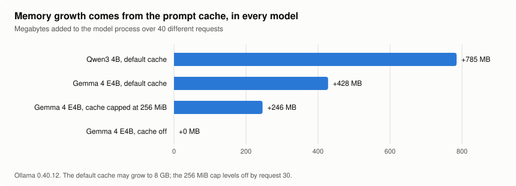
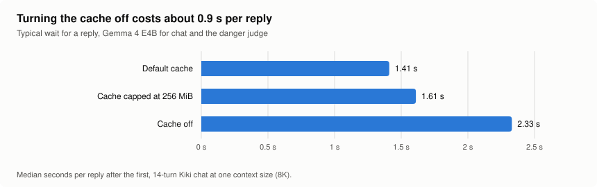

# The "Gemma leak" is Ollama's prompt cache (2026-11-01)

The model-selection write-up reported that Gemma 4 E4B leaked about 69 MB of
memory per request under Ollama. A closer look found that this was wrong. The
growth is real but has a different cause: the prompt cache in llama.cpp's
server (which Ollama runs for every model). It affects **every model**, not
just Gemma; it has a limit; and one setting controls it. Receipts:
`evals/receipts/technical-test/prompt-cache/`.

## Summary

- **Cause:** `llama-server` keeps finished prompts in RAM so that a prompt it
  has seen before can resume without being read again (`--cache-ram`, env
  `LLAMA_ARG_CACHE_RAM`). Its default limit is **8192 MiB**. Each new prompt
  adds roughly 10-20 MB until that limit is reached.
- **The earlier figure was a measuring error.** That test sent the same prompt
  20 times. Repeated prompts add nothing, so its Gemma number was mostly the
  model warming up. Different prompts grow Qwen3 4B *faster* than Gemma
  (+785 MB against +428 MB over 40 requests).
- **Cache off** (`LLAMA_ARG_CACHE_RAM=0`): no growth for any model, but each
  chat reply takes about **0.9 s longer**.
- **Cache capped at 256 MiB:** growth levels off at about +250 MB and replies
  cost about 0.2 s more than with the default. **This is the recommended
  setting.**
- Separate finding: **Gemma's image reader costs about 1.5 GB** of committed
  memory (8.1 GB at load with it, 6.6 GB without).

## Method

All tests ran on the owner's PC (GTX 1080 8 GB, 16 GB RAM) with Ollama 0.40.12,
which bundles llama.cpp commit `5320c87ff`. The measure was the committed
memory of Ollama's model process (`llama-server.exe`), which counts against
RAM plus the page file. Requests went straight to Ollama, each one a different
short coding prompt (4K context, 150 tokens out, thinking off). For each
setting, Ollama was restarted with `LLAMA_ARG_CACHE_RAM` set for that process
only; the server log confirmed the setting ("prompt cache is disabled").

Reply times came from a 14-turn casual conversation through Kiki's chat path,
with Gemma writing replies and also running the danger judge. Every call used
the same 8K context, so no reloads were involved.

## Memory

| Setting | Model | Committed at load | Added over 40 different requests |
| --- | --- | --- | --- |
| Default (8192 MiB) | Qwen3 4B | about 4.0 GB | +785 MB |
| Default | Gemma 4 E4B | about 8.1 GB | +428 MB |
| Default | Gemma 4 E4B without its image reader | about 6.6 GB | +392 MB |
| Capped at 256 MiB | Gemma 4 E4B | 8.1 GB | +246 MB, flat from request 30 (8,335 then 8,336 MB) |
| Off | Gemma 4 E4B | 8.1 GB | 0 |
| Off | Qwen3 4B | 4.0 GB | 0 |

With the default limit, a model that stays loaded and sees new prompts keeps
growing until it has added 8 GB. On a 16 GB machine that means pressure on RAM
and the page file over a long session. Ollama unloads a model after five idle
minutes, which clears the cache; that is why the problem appeared in long
benchmarks and not in short chats.

## Speed

| Setting | First reply | Typical reply | Slowest |
| --- | --- | --- | --- |
| Default cache | 14.8 s | **1.41 s** | 1.84 s |
| Capped at 256 MiB | 15.7 s | 1.61 s | 2.71 s |
| Off | 13.5 s | 2.33 s | 2.97 s |

Why switching the cache off costs time: each of Kiki's chat turns runs the
danger judge (a short prompt) and then the reply (the long prompt) on the same
model. The model has one working slot. Without the cache, the judge's prompt
replaces the conversation in that slot, so the whole conversation (about 3,000
tokens) is read again for every reply. With the cache, the conversation is
restored from RAM. A small cap holds the few prompts Kiki alternates between.

## Fix options

1. **Cap the cache at 256 MiB (recommended).** Bounded memory, nearly full
   speed. For development on Ollama, set `LLAMA_ARG_CACHE_RAM=256` as a user
   environment variable and restart Ollama; this changes the owner's system
   settings, so it waits for approval. When Kiki runs its own engine
   (llama.cpp's server, build order stage 8), Kiki passes `--cache-ram 256`
   itself, and the user changes nothing.
2. **Turn the cache off.** No growth, about 0.9 s slower per reply. Use this
   only if the cap misbehaves.
3. **Leave the default and rely on idle unloading.** Acceptable for short
   sessions; not for a long working day with the model kept loaded.
4. **A newer Ollama.** 0.40.13's notes say nothing about this, and the cache is
   llama.cpp behaviour working as designed, so an update is not expected to
   change it.

Related settings for Gemma's model profile (normalization layer): one context
size per model (no reloads), the cache cap, and whether to load the image
reader at all (1.5 GB) until an image tool needs it.

## What changes elsewhere

- The leak no longer forces the switch to llama.cpp's server earlier; the
  switch still has its other reasons (adapter switching, load control).
- "Gemma leaks" was wrong and is corrected in the model-selection write-up and
  the build order. The model decision is unaffected: under the same
  conditions, Gemma grew less than Qwen3.

## Caveats

- One machine, one Ollama version, 40 requests per setting. The latency runs
  are single 14-turn conversations, so differences of about 0.1-0.2 s are
  within noise.
- The 256 MiB figure is a measured working value, not a tuned optimum.
  Long conversations at 16K or 32K have larger saved prompts and may need a
  larger cap; recheck this when the context presets are wired into the engine.
